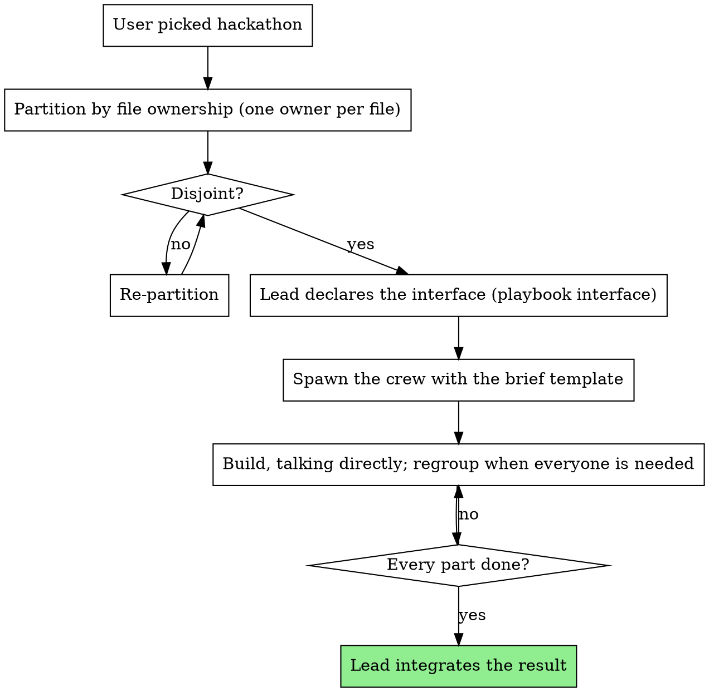

# Hackathon Team

## Overview

A small crew of specialists, such as backend, web and iOS, each owning one part and talking directly to each other while they build, like a few friends at a hackathon. One person always takes more of a leadership role (the lead talks to the user), but everyone is working together. It is a thin choreography over Claude Code's native agent-teams primitive: teammates are spawned with the `Agent` tool and auto-form, are addressed by name with `SendMessage`, and coordinate through a shared task list and direct messages. The engine routes here when the user picks hackathon, which it recommends for small to medium feature work split across platforms or specialisms that must keep talking (one feature landing on iOS, Android and the backend at once), or for a fast project kickoff where time matters more than polish. Nothing big: a large build is workflows or gsd.

**Note:** Claude Code agent teams are experimental and disabled by default. Set `CLAUDE_CODE_EXPERIMENTAL_AGENT_TEAMS=1` to enable them. Playbook's overlay says at session start whether they are on; when they are off, this mode is unavailable and drops off the shortlist.

**Core principle:** Co-located peers, partitioned once by file ownership, then left to talk. Less is more (tenet 8): the smallest crew that fits the partition, usually three.

**Route line:** `playbook route hackathon <reason>`, shown as "🤝 **Playbook** `hackathon` *small crew, one owner per part*".

## The crew

- **The lead** talks to the user, partitions the work by file ownership before anyone is spawned, declares the shared interface, and builds too. It is a colleague with the user's ear, not a hub: it never collects proposals to reconcile them itself, and hears about a question between two parts only when it touches the user, the partition, or a disagreement the two cannot settle. It holds coordination authority, not intellectual authority; teammates push back with technical reasoning and the lead does not override correct judgement by fiat.
- **The interface has one owner**, named in every brief: the teammate whose part implements most of it (the server, say), or the lead when its own part does. It holds only what everybody depends on; agreements between two parts stay in their messages and their own code. Changing it is how anyone calls the whole crew to regroup, below.
- **Teammates** are specialists. Each owns one part and its files. Two teammates never own the same file: there are no isolated worktrees here, so the partition is the only collision guard.
- **Teammates do their own reading and do not spawn helpers.** Named helpers under a teammate are how reports get orphaned.

## Talking while building

- Talk directly to the colleague a question or change concerns, never through the lead. Every brief names the whole crew, so each teammate knows who to ask.
- Run long commands in the background and check messages often.
- Mailboxes are slow: a message reaches its receiver only when the receiver's turn ends, and a burst of them backs up behind each other. So to read a message you have been told about, end your turn and carry on once it arrives. Message for a question, an answer, a regroup or part-done, like a Slack ping. Put several points in one message, never send progress chatter, and never acknowledge an acknowledgement.
- The lead takes the smallest part, so it can answer between steps rather than leaving teammates waiting.
- Waiting on a colleague with nothing else to do is fine: declare it and idle until their reply wakes you.
- The lead declares the shared interface with `playbook interface [<name>]`, before anyone is dispatched. Playbook keeps it in its own storage, outside the project, so it never lands in the user's repository: the command creates the interface and its draft and prints both paths, which go in every brief. The lead fills it by editing the draft and running `playbook publish <what changed>`; before anyone is on the crew that only numbers the version. Editing your own files never checks it.

## Message priorities

The message's first word says how hard it interrupts. One tag per message; the hook refuses a second.

| Tag | Use it when | The receiver |
|---|---|---|
| none | it can wait until they next look | gets it when their turn ends, as usual |
| `SOON:` | their next piece of work depends on it | is told at its next step: "📨 Read <sender>'s message before your next piece of work." |
| `ASAP:` | what they are doing now is wrong or wasted | is told at its next step: "📨 Stop as soon as you reasonably can and read <sender>'s message." |
| `URGENT:` | carrying on would do damage; one colleague only | has its turn ended at its next step, so the message arrives at once |
| `REGROUP:` | you have just published a change to the interface and called a regroup | is told at its next step to stop as soon as it reasonably can and read the regroup message |
| `RESUME:` | the regroup has closed | gets it as usual |

- URGENT to everyone is refused: to stop everyone, publish a change to the interface and send REGROUP. Only the regroup's caller sends REGROUP, and RESUME is refused while the regroup is open.
- The lead is never force-stopped: an URGENT to the lead arrives as ASAP. A second URGENT from the same sender to the same colleague within 10 minutes arrives as ASAP, and the sender is told. Every URGENT is logged.
- A colleague who is idle gets any message at once, so nothing extra is added.
- Tags apply in hackathon only; elsewhere Claude Code delivers to a subagent at its next tool call anyway.

## Regrouping

When someone really needs everybody's attention, they publish a change to the interface, and that calls a regroup:

1. **Drafting.** Once the crew is working, nobody edits the interface itself. A change is made in its draft, the `.draft.md` beside it, which anyone may edit freely, so typos and wording are fixed before anyone is held. Playbook numbers each published version, so keep no version line in the file.
2. **The call.** `playbook publish <what changed>` copies the draft over the interface and calls the regroup. The publisher counts as aligned and messages every colleague once, the lead included: `REGROUP: <what changed and why>`. That message wakes anyone idle, and an idle lead hears of the regroup no other way.
3. **The hold.** Every crew member's edits are held, the lead's included, through the shell as much as the Edit tool (reading, tests and messages still run), and each hears about it in the result of its next step. Nobody publishes again until everyone has agreed.
4. **Aligning.** The crew talks it through by message until everyone is happy to resume. Then the interface's owner puts the agreed version in the draft and publishes it, once, and tells each colleague it is published. A publish while the crew is aligning clears every approval so far, and everyone is told at their next step.
5. **Approving.** Each crew member reads the latest version (the Read tool, or `cat` in the shell) and runs `playbook aligned <name>`. The hook accepts it only from someone who has read the current version. Anyone who disagrees, or finds their side misrecorded, does not approve; they message the owner instead.
6. **Resuming.** When the last crew member approves, the hold lifts and every crew member is told at its next step; that member also messages everyone `RESUME: interface v<n> aligned`, which wakes anyone idle.
7. **A stuck regroup.** If someone never approves, the lead messages them, then may end it with `playbook resume <reason>`, which is logged, and every crew member is told at its next step. A teammate that has declared part-done is not counted.

## Declaring state

The idle hook acts only on a teammate that is about to go idle as "available", using what the teammate has declared with a `playbook` shell command:

- `playbook status`: prints the mode, any open regroup and who has aligned, and the teammate's own declaration.
- `playbook waiting <name> on <colleague> <what>`: the teammate is waiting on a named colleague's reply. It may idle, and it wakes when messaged. Any message sent to it clears the mark.
- `playbook part-done <name>`: declared only when no regroup is open and colleagues no longer need the teammate; the hook refuses it during a regroup. At its next idle the hook stops the teammate's work. It can still answer the lead, and the lead shuts it down once its part is integrated. A shut-down teammate cannot take follow-up questions: the lead starts a fresh teammate for any follow-up.
- Neither declared, with open items still on the task list: the idle hook sends the teammate back to work with feedback naming both commands, at most three pushes in a row. Any declaration by the teammate, or any message sent to it, resets the count. Past the cap it idles normally and the lead sees the ordinary idle notice. A teammate with nothing open idles normally, and a "failed" idle is never touched.

Use the teammate's own name in both commands.

### Brief template for each teammate

```
You are <name>, the <specialism> on this crew. The goal: <one-line goal>.
You own: <files>. Nobody else edits them. Do your own reading; do not spawn helpers.
The crew: <name> (<specialism>, owns <files>), one line each, the lead included.
Talk directly to the colleague a question or change concerns. Message the lead
(<lead name>) only for a question for the user, a change to who owns what, or a
disagreement you cannot settle with a colleague.
The shared interface is kept by Playbook at <interface path>, owned by <owner>. Read it there. It holds only what everybody depends
on. Never edit it directly: make a change in <draft path> and put it in place with
`playbook publish <what changed>`. Publishing calls the whole crew to regroup, so do it only
when you really need everyone: then message each colleague, the lead included,
"REGROUP: <what and why>". During a regroup your edits are held, in the shell too: talk it
through, let <owner> publish the agreed version, read it, then run
`playbook aligned <name>`. The last to align messages everyone "RESUME".
Run long commands in the background and check messages often. Put several points in one
message; waiting for a colleague's reply with nothing to do is fine. A message reaches you
when your turn ends, so to read one you are told about, end your turn and carry on.
Start a message with one tag when it can't wait: "SOON:" (their next piece depends on it),
"ASAP:" (what they are doing now is wrong or wasted), "URGENT:" (carrying on would do
damage; one colleague only). REGROUP and RESUME are only for the regroup above.
If you are waiting on a colleague: `playbook waiting <name> on <colleague> <what>`
When your part is done and no regroup is open: `playbook part-done <name>`
```

## State

No shared memory between teammates. Coordination is the shared task list plus direct messages. If it matters, it is said in a message or reflected on the task list.

## Lifecycle

Teammates persist until they are shut down. `/resume` and `/rewind` do not restore in-process teammates, so treat the crew as live only within the session that spawned it. A teammate that declares part-done has its work stopped by the idle hook; the lead shuts it down once its part is integrated, along with any others that remain.

## Sizing

A small crew, roughly three to five. Widen deliberately, only with a clean partition.

## Process



## Red Flags

**Never:**
- Let two teammates own the same file.
- Spawn teammates before the partition is decided and disjoint.
- Let a teammate spawn helpers or do its reading through a sub-agent.
- Declare part-done during a regroup.
- Publish a change to the interface to settle something only two parts depend on; that is a message.
- Write the interface into the project; Playbook keeps it outside the repository.
- Let the lead override correct peer judgement by fiat.
- Route proposals or questions between parts through the lead, or have the lead collect them to reconcile.
- Use a nested joint-leads fan-out here; that belongs to interns.
- Assume `/resume` or `/rewind` brings in-process teammates back.

**Always:**
- Partition by file ownership first, one owner per in-scope file.
- Declare the interface, and keep it to what everybody depends on.
- Put the declaration commands, the regroup, the whole crew and the interface owner in every teammate brief.
- Start a fresh teammate for a follow-up to one that has been shut down.

## Integration

**Before this skill:** `playbook:playbook` routes here after the user's pick. The overlay, the nine tenets and the standing override stay live throughout; this skill does not restate them. The substrate asks the user to confirm before teammates spawn; honour that step.

**Substrate:** native Claude Code agent-teams, which needs `CLAUDE_CODE_EXPERIMENTAL_AGENT_TEAMS=1`.

**Not this skill:** unnamed background helpers that report once are interns. Worktree-isolated sessions are `playbook:worktrees`.
