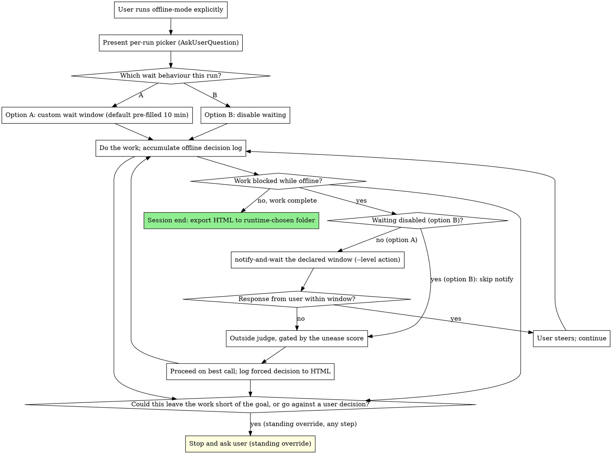

# Offline Mode

## Overview

Offline mode enables tenet 5 behaviour for a single session: a wait-then-escalate path, a push notification channel via Pushover or ntfy, and a morning-readable HTML decision log. It is reached only when the user runs it explicitly. It is never enabled implicitly, never inferred, and never carried over from a previous run.

**Core principle:** Absence is not permission. When the user is away, wait the window the user declared this run, get an outside judge's view, and only then proceed on the best call, logging every absent-decision so the user can read exactly what happened in the morning. Going against a user decision is never a best call; it waits. More scope is a judge's call only when the user's goal needs it and it is achievable.

**Announce at start:** "📴 **Playbook** `offline` *enabling offline behaviour for this session and declaring the wait window now*"

This skill does not re-explain `AskUserQuestion`, native subagents, or the score's mechanics; it specifies only the offline-specific behaviour that closes the tenet 5 gap.

---

## Division of labour with /goal

`/goal` (native Claude Code) owns the "am I actually done?" loop. Playbook offline-mode owns:

- The North Star, carried into every step.
- The per-run wait-window picker.
- The notify pull-back.
- The offline path of the unease score (below).
- The morning HTML decision log.

There is no duplication between them. You may suggest pairing with `/goal` for the done-loop while offline-mode handles absence and escalation.

---

## Per-run declaration, never remembered

On every invocation, present an interactive picker (via `AskUserQuestion`) for the wait behaviour. There are exactly two options:

- **Option A, custom wait window.** A wait window during which the user is notified and the work waits for a response before proceeding. The picker's default is pre-filled at 10 minutes; the user can accept 10 minutes or set a different duration.
- **Option B, disable waiting.** No waiting; the work proceeds without holding for a response.

Once the choice is made, record it mechanically: run `scripts/offline on --window <minutes> --wait a` for option A, or `scripts/offline on --window 1 --wait b` for option B. Option B still needs a positive `--window` value, because `scripts/offline` rejects 0; with waiting disabled the value is never used, so `1` is the convention. When offline behaviour ends, run `scripts/offline off`. Once the flag is set, the hooks push mechanically, straight off the platform's own Notification event, whenever the session genuinely needs the user: a permission prompt, an MCP input request, a usage limit that halts the run, or an idle after a final reply that asks the user something (that question becomes the notification body). An idle after a reply that asks nothing, and a finished background session, are logged as `notify_held` rather than pushed. Held idles and completions still land in the log (`notify_held`), so the morning HTML shows them.

The choice is not persisted and is not inferred from any previous run. The user must declare it fresh every single invocation. There is no remembered default beyond the pre-filled 10 minutes shown in option A, and even that pre-fill is a starting value for the picker, not a persisted setting.

---

## Notification provider

Two providers are supported. Config is read from the machine-global `~/.local/state/playbook/` unless the current project keeps its own `.claude/playbook/` files, which override it, so ntfy or Pushover can be set up once and reused everywhere. The provider comes from `notify-provider` (values: `pushover` or `ntfy`); if that is absent but an `ntfy-topic` exists, ntfy is used.

**Pushover is the recommended choice for iOS users.** Pushover holds an Apple Critical Alerts entitlement; when the user enables Critical Alerts in the app, a priority-2 message bypasses Do Not Disturb and Focus modes reliably. This is guaranteed by Apple's entitlement grant, not a best-effort signal.

**ntfy is the free, Android-friendly, and self-hostable option.** Priority 5 on ntfy bypasses DND well on Android. On iOS as of mid-2026, ntfy max priority is best-effort: Apple does not grant ntfy the Critical Alerts entitlement, so DND bypass is not guaranteed. If the user is primarily on iOS and reliable lock-screen waking matters, Pushover is the right choice.

---

## Provider setup

First-time setup is a guided walkthrough, shared with `/playbook:setup`, in `notify-setup.md` (this skill's directory). It asks whether the phone is iPhone or Android, explains ntfy (free) versus Pushover (a one-off cost, better iOS wake-through) in plain words, configures the chosen one globally under `~/.local/state/playbook/`, offers an Android QR to subscribe in one tap, and finishes by sending a live test ping. Follow it step by step.

**Offer it, do not assume it.** The first time offline mode needs a channel and none is configured (no `notify-provider` or `ntfy-topic` resolves), offer setup as yes / not now / never, the same three-way choice as the first-run `/playbook:hello`:

- **yes**: walk the user through `notify-setup.md`.
- **not now**: run this session without notifications and offer again another time.
- **never**: write `skipped` to `~/.local/state/playbook/notify` and do not offer again unprompted; the user can still set it up later by asking or via `/playbook:setup`.

If a channel is already configured, or `~/.local/state/playbook/notify` already reads `skipped`, skip the offer and carry on.

---

## Picker questions while offline

The routing picker carries an `Oversight:` question, and its answer turns offline behaviour on or off without running this skill: `You'll oversee` is online, `Autonomous development` is option B with no pushes, and `Defer to a judge after 10 mins waiting` or `Defer to a judge after 30 mins waiting` is option A with that window. The hooks record it, so nothing needs running.

While offline is on, the hooks never let a question open a dialog that would block the run. Under option B they answer it with the recommended options and log it, pushing it to the user's phone unless they chose autonomous development. Under option A they push it and refuse the dialog, and you ask it in your reply too: wait the window for a typed reply with a background `sleep`, carry on with work that does not depend on it, then take the top recommendation and log it. Confirm a picker's goal with `playbook goal <mode> <goal line>`. If a question closes unanswered on Claude Code's own idle timeout (the user's `askUserQuestionTimeout` setting), the hooks take its recommended answers and switch to option B, except a goal picker, which waits for the user.

An offline run with a judge overseeing tends to be workflow-heavy, and nobody is there to type "use ultracode" before each launch. So if the work routes to workflows, settle the plan, then ask the user to run `/effort ultracode` before they go, warn that it stays on for the session, and remind them in the morning log to switch back to their earlier effort. If it is still off at launch time, wait the window, then take the next-ranked mode and log why.

Going against one of the user's decisions is never a judge's call. More scope is, when the user's goal needs it and it is achievable. A minor unrelated bug fix or a nice-to-have change waits until the work has been delivered, then goes to the user as a possible extension. Anything that waits for the user waits however long that takes, and the work that does not depend on it carries on.

When a review comes back, the pause after a review (see `playbook:playbook`) works as online. Each `playbook weigh` call goes into the log. A `playbook weigh bigger` is signed off by a judge once the declared window has passed, or straight away under option B, within the rule above.

---

## Agent latitude and notification levels

The running agent chooses the notification level per event. The levels map as follows:

| Level | When to use | ntfy | Pushover |
|---|---|---|---|
| `info` | Progress, heads-up, non-blocking update | Priority 3 | Priority 0 |
| `action` | The user is needed to steer; work is waiting | Priority 4 | Priority 1 |
| `critical` | Genuinely urgent, warrants waking the user | Priority 5 | Priority 2 |

`critical` bypasses DND on Pushover (when Critical Alerts are enabled in the app) and is best-effort on ntfy. Use it only when the situation genuinely warrants waking the user, and state an explicit reason when you do. It is not a substitute for `action` on every notify-and-wait step.

The alarmed push defaults to `action`. Escalate to `critical` only if the situation deteriorates while waiting (for example, a second notify after the first goes unanswered and the issue is time-sensitive).

---

## Decision log

While offline mode is active, accumulate a running log of events that occur specifically because the user was absent:

- Forced-without-you decisions made after the wait window elapsed.
- Judge consultations.
- Waits.
- Notification sends (all levels).

The log is durable JSONL at the path `scripts/offline` reports when offline mode is turned on (`<state-dir>/offline-log.jsonl`, also printed by `scripts/offline status`). Notification sends (`notify`) and the idles and completions held back from the phone (`notify_held`) land there automatically via the hooks; log every other event yourself with a `scripts/offline log '{"event":"decision","summary":"...","reason":"..."}'`-style call, one JSON object per event.

Online runs produce no log. The log accumulates only while offline mode is active; outside an offline-mode session there is no decision log at all.

---

## HTML export

At the end of the session, read the durable JSONL log (`<state-dir>/offline-log.jsonl`, the path `scripts/offline status` reports) and render it, not conversation memory, to a clean, simple-to-read HTML document using `decision-log.html.tmpl` in this skill directory. Save it to a folder the user chooses at runtime: either the project root, or a dedicated logs folder outside the root. The destination folder is chosen at runtime, not fixed in advance and not persisted between runs. The intent is a document the user can read calmly in the morning, so keep it legible at a glance. End it with a **Possible extensions** section listing the minor unrelated fixes and nice-to-haves held back for the user.

---

## The score's offline path

Offline mode occupies the offline branch of the unease score. The standing override sits above it and is independent of the level and the mode:

> If a choice could leave the work short of the goal, or go against one of the user's decisions, stop and ask.

Playbook scores unease from evidence and you can add to it with `playbook unease <level> <reason>`. The levels act as follows, offline:

- **Uneasy:** rethink before the next edit or dispatch, as online.
- **Concerned:** consult a judge before more edits or dispatches, as online. The judge is outside the work: a foreground `Agent` call whose description starts `judge:`, or `codex:codex-rescue`.
- **Alarmed:** push to the user's phone with `scripts/notify --level action`, wait the declared window, then take an outside judge's view and carry on. Under option B the push is sent and there is no wait; the judge's view is taken straight away. If the judge's view or the decision involves scope or a user decision, it waits instead.

Whatever is decided without the user is logged to the offline HTML.

---

## The notify seam

The skill specifies a single integration point: the `scripts/notify` contract shipped with the plugin. While offline mode is on, the hooks fire `scripts/notify` mechanically for blocking events and for idles whose final reply asks the user something, straight off the platform's Notification event; the skill's own direct sends are reserved for richer mid-work updates that carry more context than the hook alone can.

**Contract.** `scripts/notify [--level info|action|critical] [--link <url>] "<headline>" ["<detail>"]`. The headline is the lock-screen key action seen first (the title renders as `📚 Action: <headline>`, `📚 Info: <headline>`, or `📚 Critical: <headline>`); the optional detail is the notification body and defaults to the headline. Back-compat: `--category=action` and `--category=info` are accepted as aliases.

`--level action` (the alarmed push) is an urgent push that pulls the user back to steer. `--level info` is the calmer channel for heads-up sends recorded in the decision log. `--level critical` bypasses DND; use it only when genuinely warranted and state an explicit reason.

The script is invoked at the alarmed step when the work blocks while offline mode is active and option A was declared this run, and again for any further send that the decision log records. Under option B (waiting disabled) the wait is skipped.

**Config resolution.** Every key below is read from the project's `.claude/playbook/` first, then the machine-global `~/.local/state/playbook/`. A project file overrides the global one for that key, so notifications are configured once globally and only overridden where a project needs its own account or topic.

**Provider selection.** `scripts/notify` reads `notify-provider` to choose between `pushover` and `ntfy`. If that file is absent but an `ntfy-topic` exists, ntfy is used.

**ntfy config.** Topic at `ntfy-topic`. Optional server override at `ntfy-server` (default `https://ntfy.sh`).

**Pushover config.** App token at `pushover-token`. User key at `pushover-user`. Emergency (priority 2 / `--level critical`) requires retry and expire fields; the script sets `retry=60` and `expire=1800` automatically. A critical send returns a `receipt` token in the Pushover API response; `scripts/notify` captures it to `~/.local/state/playbook/last-receipt`, never into the project (overwritten on each critical send). Wiring this receipt into an acknowledgement-polling loop is a future step: the file is capture-only for now.

**Remote-control deep-link.** When `/remote-control` is active in the live session, the notification carries a tappable link that opens the recovered session URL straight from the lock screen (ntfy: Click header; Pushover: url field). The URL is read from the current transcript (the latest record of `type=="system"` and `subtype=="bridge_status"` whose content carries `is active`). When the bridge is inactive or absent the link is omitted: silent degradation, never a wrong link. `--link <url>` attaches an explicit URL instead.

**Exit codes.** `0` success, `3` publish failed, `4` no topic or credentials configured, `5` `curl` not installed, `64` usage error. The skill should react meaningfully when a send fails rather than swallowing it.

---

## Process

---

## Red Flags

**Never:**
- Enable offline mode implicitly, by inference, or by carrying over a previous run. It is explicit, per run, every time.
- Remember or persist the picker choice across runs, or infer it from a previous run. The user must declare it fresh every invocation.
- Produce a decision log on an online run. Online absence means blocked and we wait; the log accumulates only while offline mode is active.
- Treat the notify seam as optional under option A. When a wait window was declared, the notify-and-wait is the offline block path and every send is a logged event.
- Fire the notify-and-wait under option B. When waiting was disabled this run, that step is skipped entirely.
- Take the outside judge's view before the alarmed push under option A, or treat it as routine. It is gated by the unease score.
- Fix the HTML export destination in advance or persist it. The folder is chosen at runtime, project root or an external logs folder.
- Bypass the standing North-Star override because a wait window is running. The override sits above the whole score.
- Use `--level critical` routinely or without an explicit stated reason. It wakes the user; reserve it for situations that genuinely warrant that.

**Always:**
- Declare the wait behaviour fresh every run via the per-run picker, option A custom window (default pre-filled 10 minutes) or option B disable waiting.
- Log every forced-without-you decision, judge consultation, wait, and notification send while offline mode is active.
- Notify via `scripts/notify --level action` and wait the declared window before any outside-judge step, unless waiting was disabled this run.
- Take an outside judge's view first, where the unease score warrants, before a forced call.
- Treat going against a user decision as waiting for the user, never as a best call, and a nice-to-have or a minor unrelated fix as a possible extension for the morning.
- Export the HTML decision log to the folder the user chooses at runtime at session end, morning-readable.
- Apply the standing override at every step, whatever the unease score and the mode.
- State an explicit reason when escalating to `--level critical`.

---

## Integration

**Before this skill:**
- `playbook:playbook` is the routing engine. It restates the North Star, batches questions, and routes. It routes here only when the user explicitly enables offline behaviour for tenet 5; offline mode is never implicit. The overlay, the nine tenets (held in the engine skill) and the standing North-Star override stay live throughout; this skill does not restate them.

**Division of labour:**
- `/goal` owns the "am I actually done?" loop. This skill owns absence, escalation, and the morning log. Suggest pairing with `/goal` when the task has a clear completion criterion.

**The unease score:**
- Offline mode is the offline path of the score used by tenets 4 and 5: alarmed pushes to the phone and waits the declared window, then an outside judge's view, then the forced call logged to the offline HTML.

**The notify seam:**
- `scripts/notify [--level info|action|critical] [--link <url>] "<headline>" ["<detail>"]` sends to the user's phone via the configured provider. Topic or credentials live in `.claude/playbook/`; the Click or url field deep-links back to `/remote-control` when it is active, otherwise omitted.

**Substrate:**
- Native Claude Code plus `curl`. `AskUserQuestion` drives the per-run picker; native subagents and Codex handle the outside-judge consultation; `scripts/notify` ships with the plugin. No further dependency: still part of the common path.
